### Hi there 👋

<!--
**chaojian-zhang/chaojian-zhang** is a ✨ _special_ ✨ repository because its `README.md` (this file) appears on your GitHub profile.
-->

 

- 🔭 I used to work as a Generalist Programmer at BBI during 2021-2022 and worked on Minecraft Legends
- 🎮 I am a fan of Dwarf Fortress, and I am creating my own simulation game [Deep Dive](https://youtu.be/Rd8E-iSiLZ0)!
- 🌱 I’m currently learning CG concept design from CGPB -> learning to use RenderMan to build custom CGI pipeline -> developing my own rendering pipeline
- 🚀 I am the developer of [Divooka](https://methodox.itch.io/), a visual programming system. It started as a cool concept software called "[Parcel](https://github.com/MethodoxParcel/Parcel_V1)" (then available as [Expresso](https://charles-zhang.itch.io/expresso)), and is a direct result of developing and using [Pure](https://github.com/Pure-The-Language).
- 🌎 The latest mega-project I am working on (besides the long-term mysterious [Project Nine](https://nine.totalimagine.com/ArtOfAI)) is called "The Matrix"
- 🧡 My favorite programming languages (among others) are: Ruby, C#, C++, Prolog, Elixir, Lua and now (2024) Java and (2025) Divooka!
- 🤔 I’m looking for help with developing a new scripting language (~~[Formless](https://chaojian-zhang.github.io/FormlessProgramming/)~~ Nope, let's do [Pure](https://github.com/Pure-The-Language) instead😆)
- 👯 And to carry on my semi-finished work on [Somewhere](https://github.com/Charles-Zhang-Somewhere/Somewhere) (maybe [Somewhere 2](https://github.com/Charles-Zhang-Somewhere/Somewhere2))
- 💬 Ask me about anything!
- 📫 How to reach me: charles@totalimagine.com
- ⚡ Fun fact: I am not religious but I am deeply spiritual
- 💎 I am also a big believer of the syntactic elegance of a programming language
- 🧘‍♀️ Another fun fact: Experimenting (and highly experienced) with lucid dreams💤

Company Website: https://methodox.io/
